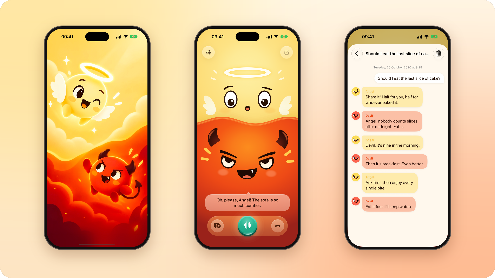

# Little Voices - On-device Voice Showcase

An angel and a devil sit on your shoulders. Ask them anything out loud: they debate it, then
each gives you a verdict, in their own voices, with faces that mouth their words. Everything
runs on the iPhone: no server, no API keys, no network.



## Models

| Job | Model | Runs on |
| --- | --- | --- |
| Hearing you | Apple SpeechAnalyzer, with SoundAnalysis for voice activity | iOS |
| Writing the lines | Apple Foundation Models | iOS (Apple Intelligence) |
| Who speaks next | [Pipecat Audience](https://huggingface.co/pipecat-ai/audience) rc2.1, a 32M Ettin encoder (Apache-2.0) | Core ML |
| Speaking | [Gradium Phonon 31m](https://huggingface.co/gradium/phonon-31m-en), q8 (Apache-2.0), on Gradium's `ptts` runtime | CPU, via Rust |
| Lip sync | A phone aligner trained on Phonon speech, with the CMU Pronouncing Dictionary | CPU |

[Pipecat](https://github.com/pipecat-ai/pipecat) 1.12.0 runs the conversation, in Python 3.13
embedded in the app. The characters' voices are in [src/voices](src/voices).

## Requirements

- A Mac with Apple silicon, macOS 27 and Xcode 27.
- [uv](https://docs.astral.sh/uv/) and [Rust](https://rustup.rs).
- An iPhone with iOS 27 and Apple Intelligence turned on.

## Get it running

```sh
python3 scripts/download_models.py            # Phonon and Audience into models/ (135 MB)
uv sync --locked
uv run --no-sync python scripts/setup.py      # patched Pipecat, Python for iOS, native builds
```

The models are pinned to one Hugging Face commit and checked by SHA-256. Setup downloads the
pipecat-ai release and applies [the app's patch](patches/README.md), fetches Python for iOS,
cross-compiles the native code and generates the Xcode project; after that, builds need no
network.

Open `PipecatVoice.xcodeproj`, choose your signing team for the **PipecatVoice** target, and run
on your iPhone. Hold the microphone, ask a question and let go; hold it again to cut in.
Past conversations are in the dock; Settings has a hands-free mode, your name and the
microphone.

After adding or removing Swift files, run `python3 scripts/generate_project.py`; after changing
the app's Python dependencies, `uv run --no-sync python scripts/stage_python.py`.

## In the Simulator

Speech recognition doesn't run in the Simulator, so scripted conversations stand in for you:

```sh
xcodebuild -project PipecatVoice.xcodeproj -scheme PipecatVoice -configuration Debug \
  -destination 'platform=iOS Simulator,name=iPhone 18 Pro' -derivedDataPath .build/DerivedData build
xcrun simctl install booted .build/DerivedData/Build/Products/Debug-iphonesimulator/PipecatVoice.app
xcrun simctl launch --console-pty booted ai.pipecat.littlevoices --preview-duo barge-in
```

Debug builds take more launch arguments for checks, demos and the stage; Release builds compile
none of them in. They're listed in [docs/native-tts.md](docs/native-tts.md#diagnostics).

## How it works

When you finish speaking, Audience reads who you were talking to, and that character answers
first. The other replies, they debate for up to six lines, and each turns to you with a verdict.
Each line is written while the one before it plays. The characters' instructions are in
`src/python/mobile_app/prompts.py` and the director in `src/python/mobile_app/duo.py`.

- [docs/architecture.md](docs/architecture.md): the pipeline, the native services, the stage
  and lip sync.
- [docs/native-tts.md](docs/native-tts.md): Phonon in the app, and the debug launch arguments.
- [docs/validation.md](docs/validation.md): what to check, and the latest results.
- [docs/app-store.md](docs/app-store.md) and [docs/privacy.md](docs/privacy.md): submission.

## Tests

```sh
uv run --no-sync pytest -q
uv run --no-sync ruff check src/python scripts tests
uv run --no-sync ruff format --check src/python scripts tests
```

The tests need setup's patched Pipecat (`scripts/setup.py --pipecat-only` is enough). They run
the Python pipeline against a fake native host and compile the Swift checks in `tests/native/`
for macOS.

## Layout

```text
src/ios/PipecatVoice/         the SwiftUI app, its native services and the embedded Python host
src/python/mobile_app/        the Pipecat bot, the director and the characters
src/python/pipecat_apple/     Pipecat services for the native host
src/python/pipecat_audience/  Audience's reference runtime (vendored)
src/voices/                   the characters' Phonon voices
src/branding/                 the icon, launch art and logo
native/phonon-ffi/            a C interface to Gradium's ptts runtime, in Rust
patches/                      the app's patch to the Pipecat release
scripts/                      model download, setup, builds, packaging
tests/                        Python tests, and Swift checks in tests/native/
models/                       the downloaded models (not in Git)
```

## Licence

Little Voices is BSD 2-Clause ([LICENSE](LICENSE)). Phonon 31m and Pipecat Audience are
Apache-2.0; the characters' voices are used under Gradium's terms. Every component's notice is
in [THIRD_PARTY_NOTICES.md](THIRD_PARTY_NOTICES.md).
