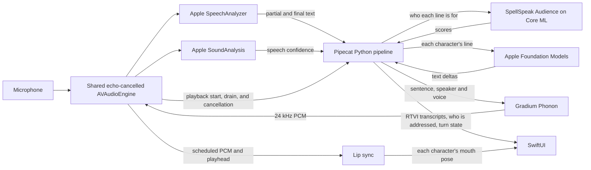

# Embedded voice pipeline



`PCPythonRuntime.m` runs CPython on its own thread, with an isolated configuration and the
bundle's import paths. The built-in `_pipecat_native` module carries JSON events both ways:
Python polls a thread-safe inbox, and its events reach Swift on the main queue. Python owns
its asyncio loop; SwiftUI runs on the main actor. There is no socket, subprocess or web
server, and no code is downloaded.

As the app comes to the front, `ConversationModel` loads Phonon's voices, Audience and the
speech model, so a conversation starts without waiting for them; at launch it waits for the
intro to play, which loading would rob of frames. Until they and Python are ready the
microphone is gray, with a spinner. The voices and Audience stay
loaded between conversations and are freed in the background; the speech model lingers after
each use.

`src/python/mobile_app/bot.py` configures the services, VAD, context and observer and returns
a `PipelineWorker`, which the embedded entry point runs with a `WorkerRunner`:

```text
AppleTransport.input() → AppleSpeechSTTService → context_aggregator.user()
                      → DuoLLMService → LLMTextProcessor → PhononTTSService
                      → AppleTransport.output() → context_aggregator.assistant()
```

The native services are the `pipecat_apple` package (`src/python/pipecat_apple/`), built on
the pipecat-ai 1.12.0 release with a small patch (see [patches/README.md](../patches/README.md)),
so another embedded Apple bot can reuse them:

| Module | Native adapter | Pipecat base |
| --- | --- | --- |
| `pipecat_apple.stt` | `AppleSpeechSTTService` | `STTService` |
| `pipecat_apple.llm` | `AppleFoundationLLMService`, `AppleLLMAdapter` | `LLMService`, `BaseLLMAdapter` |
| `pipecat_apple.playback` | `NativePlaybackTTSService` | `TTSService`, with playback acknowledged by the host |
| `pipecat_apple.phonon` | `PhononTTSService` | `NativePlaybackTTSService` |
| `pipecat_apple.vad` | `AppleVADAnalyzer` | `VADAnalyzer` |
| `pipecat_apple.transport` | `AppleTransport`, `AppleRTVIObserver` | transport bases, `RTVIObserver` |
| `pipecat_apple.bridge` | `AppleNativeBridge` | request correlation and session lifecycle |

Apple's partial transcripts become `InterimTranscriptionFrame`s and its final ones
`TranscriptionFrame`s, and the standard aggregators build each turn's `LLMContextFrame`. The
`LLMTextProcessor` splits replies into sentences with Apple's `NLTokenizer`
(`_pipecat_native.sentence_boundary`), since upstream's splitter, sentencex, has no iOS wheel;
a speech request holds at most 420 characters. `MarkdownTextFilter` and
`PlainSpeechTextFilter` clean each sentence: what Phonon speaks is what the bubble shows and
what enters the context, and a sentence with nothing to say aloud is skipped.
`DuoLLMService` voices the angel and the devil on one model (see
[the angel and the devil](#the-angel-and-the-devil)).

`bot.py` passes `empty_user_turn=None`: upstream's recovery appends a `developer` message,
which the Apple adapter refuses, so a turn with no final words gets no reply. The language
model writes text only; `AppleLLMAdapter` refuses a context with tools. Each request carries
the instructions, the committed conversation and the prompt.

`mobile_app.prompts.session_instructions` adds the session's notes to each character's
instructions: an optional preferred name from `start.user_name`, kept apart from both
characters. Settings stores only that name, which the contact picker can fill from a
contact's first name without Contacts access. The bridge applies the notes with a standard
`LLMUpdateSettingsFrame` before admitting input.

**Failures.** When an exchange can't begin, the host cancels the turn through the normal
interruption path, keeps capture and the conversation, and shows the error. A declined
opening the other character can take, and a later line's failure, are not errors (see
[the angel and the devil](#the-angel-and-the-devil)). Other failures stop the conversation
with a message that says what to do; the detail goes to the unified log. If SpellSpeak
Audience fails to load, Python reads lines with the rules baseline. Foundation Models'
errors are classified into stable codes (`LLM_DECLINED`, `LLM_ASSETS`, `LLM_FAILED`, …) and
logged by stage, native domain and code, and token and history counts, never prompt text;
Release builds leave the code off the banner.

**Speech.** `PhononTTSService` sends each sentence to the host with its line's speaker, voice
and line, and yields `TTSAudioPlayedFrame` once the host has played it. Its base,
`NativePlaybackTTSService`, passes a sentence's text on only then, so the assistant aggregator
commits only played text and an interruption drops the rest. Audio never crosses into Python.
See [native speech](native-tts.md).

## Native speech detection and turn boundaries

### Voice activation

`StartConversationIntent` exposes starting a conversation as a foreground App Intent, which
`PipecatShortcuts` makes discoverable in Shortcuts and Siri; a "Hey Little Voices" Vocal
Shortcut can run it, and iOS owns the phrase. `ConversationLaunchRequests` keeps a start that
arrives before the view or Python is ready, and the app starts the conversation through the
usual path once both are. Ending or backgrounding the app drops it; starting again while a
conversation runs keeps it, unmuted. A conversation started by voice is hands-free.

### Hold to talk

Settings chooses how the human takes turns (`InputMode`): holding the microphone to talk, the
default, or hands-free, where VAD ends each turn as below. A conversation keeps the mode it
started with.

Holding to talk, pressing the microphone starts a conversation if none is running. Capture
runs throughout the conversation, but ASR hears only a held microphone, and SoundAnalysis
doesn't run. While the microphone is not held, `SpeechAudioInput` keeps the last 0.3 s of
audio, which a press replays to the transcriber, so a word begun with the press is heard
whole. A press stops the characters at once, without the pre-roll, which would carry their
voice. Python gets `talk` events in place of VAD scores: a press begins a span of speech and
a release ends it. A turn still needs a recognized word, so a tap starts none, and shows
"Hold to talk" above the microphone. Listening goes on for 0.35 s after the release, for a
last word still being said, and pressing again within it carries on the same words. Then
`AppleSpeechRecognizer` finalizes ASR as an endpoint does (below) and closes it until the
next press, so Python's `finalize_asr` finds nothing left to finalize. Pressing again before
the reply begins adds to the same turn.

### Acoustic activity

Apple's `SpeechDetector` publishes no detection results, so speech confidence comes from
SoundAnalysis's built-in classifier (`SNClassifySoundRequest(classifierIdentifier: .version1)`,
its `speech` class): a 0.5 s window with 80% overlap, a score every 0.1 s. No model is
bundled for it.

`ConversationModel` hears the microphone through `SpeechInput` (`AppleSpeechRecognizer`) and
writes lines through `TextGenerator` (`AppleLanguageModel`); the DEBUG scripted
conversations stand in for either. `AppleSpeechRecognizer` uses `SpeechAudioInput` to convert
microphone audio and deliver it to SpeechAnalyzer losslessly, within a 0.75 s capture budget.
SoundAnalysis runs on its own worker, since its `analyze` call can block, keeping at most
half a second of waiting audio: when it falls behind it drops old VAD-only audio, keeps
absolute timestamps, never invents silence, and rejects stale scores. Sustained overload is
an error. Debug builds log `SPEECH_INPUT` queue metrics, never audio or words.

Python receives the scores, their timestamps and an approximate level. `AppleVADAnalyzer`
debounces them with Pipecat's VAD state machine (confidence 0.65, start 0.1 s, stop 0.6 s),
after the classifier's own window. `AppleSpeechSTTService` turns them into VAD frames and
proposes turn boundaries, which `ExternalUserTurnStrategies` in the standard user aggregator
accepts; a turn ends only once ASR's final text is in.

A turn starts only with speech and at least one recognized word: until then VAD can't create
a turn, stop playback or interrupt Pipecat, so noise doesn't cut the characters off, while a
single word such as "stop" does. Words that arrive before the first score are kept. A span
of speech without words still finalizes ASR when it ends, so a late final word can confirm a
short utterance; if none comes, the reply carries on.

Apple's `finalize(through:)` publishes final results without telling the app it has consumed
them. For a firm end of turn, `finalize_asr` ends only the current ASR input, waits for all
its final results and starts a new transcriber, cutting at the newest audio so trailing words
count. The tap and SoundAnalysis keep running, and up to four seconds of audio is replayed to
the new transcriber with its timestamps. A rotation finishes even if new speech cancels the
Python request that asked for it.

## Playback, interruptions, and RTVI

`VoiceAudioEngine` owns one `AVAudioEngine` for capture and playback. It prefers
`.playAndRecord` in the default mode with
[`setPrefersEchoCancelledInput(true)`](https://developer.apple.com/documentation/avfaudio/avaudiosession/setprefersechocancelledinput(_:)),
used only once the active session reports echo cancellation on; otherwise it falls back to
`.voiceChat` with voice processing. Capture stays on while the characters think and speak.
The default mode also lets Control Center's screen recording capture the characters.

The microphone picker (`MicrophoneInputPicker`, iOS's `AVInputPickerInteraction`) offers the
route's inputs and modes, such as Voice Isolation. On a route change the host interrupts the
turn, mutes Pipecat and suspends capture, keeping the session; once the picker closes it
restores the selected input and echo cancellation, restarts ASR and unmutes, keeping the
conversation. Generations reject stale results throughout; an unrecoverable route ends the
conversation.

Stopping a reply stops the player, not the engine; ending the conversation stops both.
Muting stops capture and ASR, and unmuting starts a fresh input, so nothing said while muted
is transcribed. `PCMPlayer` reports playback starting, draining and cancelled, which the
output transport broadcasts as `BotStartedSpeakingFrame` and `BotStoppedSpeakingFrame`;
playback generations keep an old callback from touching a new reply. Phonon's chunks are
scheduled as they arrive; if the player runs dry mid-sentence, the next chunk restarts it and
its speaker's mouth (Debug builds log `PLAYBACK_UNDERRUN`).

## The angel and the devil

One Foundation Models session plays both characters. `DuoLLMService`
(`src/python/mobile_app/duo.py`) answers each turn with an exchange of lines, each a separate
generation with its speaker's instructions and view of the conversation. SpellSpeak Audience
reads who each line is for, and the director decides who speaks next.

**Audience.** A request is built in Python with SpellSpeak Audience's reference runtime,
release rc2.1, vendored byte for byte in `src/python/spellspeak_audience/runtime/`.
- **Cards:** each person the line could be for has one: the angel, the devil, and,
  when a character speaks, the human.
- **Facts:** everyone is near and in the conversation, with who the speaker spoke to
  last and who just asked them something.
- **History:** the last four lines, with who each was for.
- **Native scoring:** the host's `audience` operation takes the cards' and line's text, the
  current line's length and the runtime's features. `AudienceTokenizer` reproduces the
  `tokenizers` library's encoding, offsets included; `AudienceModel` runs the two Core ML
  graphs, caching each card's encoding and running the head for the number of people.
- **Reading:** a line is for everyone (group at least 0.5), for nobody in particular
  (unclear at least 0.5), or for the likeliest person.
- **Fallback:** if the host cannot answer, the runtime's rules baseline reads the line.
- **Speed:** a line takes about 5 ms in an optimized build on Apple silicon.

**Who speaks.** `Exchange` turns readings into takes:
- **Opening:** a line for one character is theirs to answer first; otherwise the likelier
  character opens, and ties (equal to two decimal places) alternate between turns. The
  host is told a tied line is for both, whichever Audience found a hair likelier.
- **"Who, me?" and greetings:** an unclear line that asks nothing ("You lied to me.")
  gets a "Who, me?" from each, and a greeting or thanks gets a few words from each.
- **Debate:** the other character replies. While lines are aimed at the other
  character, the next one answers, for up to four lines.
- **Verdicts:** whoever's last word went to the other character then gives the human a
  verdict. An exchange has at most six lines.

**Views.** `Room` holds the conversation as heard:
- **Instructions:** each line is written with its speaker's instructions
  (`line_instructions`: `character_instructions` plus the session's identity notes).
- **View:** the speaker's own lines are assistant messages, everyone else's are user
  messages tagged `[Human]`, `[Angel]` or `[Devil]`, and a final `[Note: …]` says what
  the moment needs. Consecutive user lines merge, so an unanswered question stays with
  the human's next line.
- **Interrupted lines:** they keep what was heard, marked as cut off. A line of which
  nothing was played, cut before its first sentence or with nothing to say aloud, is
  dropped.
- **Bounds:** the room keeps the last 32 lines in whole exchanges.

**Timing.** Each line is written while the one before it plays. A line is generated
only once the line before the one playing has been heard, so at most one line waits.
- **Heard lines:** the assistant aggregator's `on_assistant_turn_stopped` confirms each
  line as played, or as cut short at what was heard.
- **Unheard lines:** lines written but never played are dropped at the next turn.
- **The floor:** each line's end frame says whether another `continues`, so
  `AppleNativeBridge` reports the human's turn only after the last line.
- **Failures:** lines are generated with `report_errors=False`, so a failed response is
  closed with an end frame that `continues` and the failure returns to the director. A
  declined opening (`LLM_DECLINED`) passes to the other character. A later line that fails
  is never said: the host is told it was `dropped`, the lines before it play out, and the
  floor returns. Only an exchange that can't begin is reported as an error.
- **Prewarming:** once every line is accounted for, the likely next opener is prewarmed with
  the conversation up to their last line, the next request's history.

**Voices.** A line's start frame carries its `speaker`, `voice` and `line`.
`PhononTTSService` sends them with each sentence's speak request, and
`AppleRTVIObserver` adds `speaker` and `line` to the RTVI envelopes.
- **Phonon:** one model holds both voices (`phonon_load` takes several, `phonon_speak` an
  index), so a sentence switches voice without reloading.
- **Interruptions:** cutting in marks the line being spoken and drops lines nobody heard.

**The screen.** The angel and the devil share one squishy stage (`DuoStageView`): a
full-screen `Canvas` draws both halves, the curved seam between them and both rigged faces,
from a seeded simulation stepped at a fixed 240 Hz (`StageSimulation`). Whoever holds the
floor swells into the other's half and squishes them against the floor (the devil) or the
ceiling (the angel), with anticipation, impact, overshoot and a jelly ripple on each
handover; nobody is dimmed. Text stays SwiftUI at settled slots and never wobbles
(`StageCaptions`): each character's bubble is a soft glass capsule tinted for them, cream for
the angel and peach for the devil, with one soft point toward its speaker.
- **The seam at rest:** with nobody on the floor, on the start screen as in a conversation,
  the seam is one smooth S across the middle of the band (`SeamShape.drift`, about 15 pt high
  on an iPhone and 24 pt on an iPad) that rolls right a wavelength every 11 s and swells every
  7.3 s, level on average at every moment so neither half leans into the other. It gives way
  as someone takes the floor and returns as the stage relaxes. Three minutes after the last
  input it settles into a still S and the stage sleeps; any input or the app's return sets it
  moving again. Under Reduce Motion it is that still S. A soft edge feathers a warm glow into
  the angel's side and a faint shade into the devil's, handing over to the dominant rim and
  the contact shadow as someone takes the floor. On an iPad the seam's 720-pt window eases
  into level runs to the screen's edges.
- **Who is addressed:** `DuoLLMService` emits an `addressed` event with Audience's
  reading of each line: the human's (`line` null) as soon as it is read, and each
  character's when it is written, with its `line` number. `to` holds character ids, or
  `player` for the human. With nobody on the floor, the human's question leans the seam
  toward whoever it is for.
- **Captions:** a sentence shows as its audio starts (the speak request's text, as Phonon
  speaks it). While someone holds the floor only their bubble shows, its tail under their
  mouth: inside the angel's blob, or just above the dock for the devil. With nobody on the
  floor each character's last sentence sits in its own half. A bubble never shows over its
  character's face: the speaker's waits until the seam and their face have cleared its
  slot, and a bubble that appears where the face still is, or whose slot moves across the
  face (the devil's last sentence as an exchange ends), waits for the face to move away.
- **Thinking:** a character writing their next line (from `bot-llm-started` until its
  first audio) shows typing dots: while squished, a small glass capsule beside the angel's
  head (between her halo's dashes and a wing) or in the devil's corner under the seam;
  otherwise dots in their bubble.
- **The human:** their words, live or final, float in a pill over the seam until a
  character's first line plays.
- **Chrome:** Settings and New conversation sit in the top corners. Before a conversation the
  microphone stands alone above the home indicator: hidden while the intro plays, then fading
  in, gray with a spinner while the app still loads or a conversation starts. The button
  (`MicrophoneFace`) is chunky, a matte face standing on a darker base that it sinks into when
  pressed. Before a conversation it shows a bouncing waveform, breathes, and pings a ring of
  light, inviting a press; in one it shows a microphone, teal, or red while muted, and the
  dock's glass widens around it as the input picker and End slide out from behind it. While the
  human is heard, a halo glows around it and rings ripple out (`MicrophoneAura`), added to the
  stage as light and brighter as they speak. Held to talk, it swells well out from under the
  thumb, with a firm tap as it starts listening and a light one as it is let go; hands-free, a
  tap mutes it. An error rises in a banner above the dock. The header's buttons, the dock,
  bubbles, capsules, pill and banner share one glass (`SoftGlass`): a warm tint graded lighter
  at the top, a soft light along its upper edge and, where it floats, a soft shadow. It is
  solid under Reduce Transparency and outlined under Increase Contrast.
- **New conversation:** the conversation clears at once, and a snapshot of the old screen is
  wiped away from the top behind a glowing edge that waves like the seam (`ResetWipe`), or
  fades under Reduce Motion. Core Animation runs it, so it keeps its pace while the
  conversation shuts down.
- **Faces and behaviour:** `FaceRig` springs every feature (eyes, brows, mouth, blush,
  marks) and lets the halo, wings and horns lag and wobble. The seam's press eases the
  squished devil's horns down beside his head and lets them rise as he is freed; the
  angel's wings ease to a stop just inside the screen's edges. A face's rhythms (breath,
  the laugh's bounce or shake, the vein's throb, starry eyes' twinkle) run on its own
  clock, which stands still while the stage sleeps. `CharacterDirector` gives each
  character a role (speaking, squished, thinking, listening, afterglow, resting, dozing)
  with a held expression, and a seeded agenda: blinks (some double, reopening a little
  past rest), small drifts, glances with a brow flash, the devil's eye rolls and the
  angel's sighs while squished, nods while the human speaks. Caption cues (`CaptionCues`)
  flavour the speaker (laughing, excited, asking) and prompt the listener's reactions
  after a short hearing delay (laughing along, shock, a huff, an eye roll at virtue, a
  worried head shake at temptation); taking the floor ends a listener's reaction. An
  exchange ends with a verdict (happy, content, sometimes a wink); an interruption
  (`ConversationModel.interruptions`, counted when playback stops early while someone
  holds the floor) startles both instead.
- **The intro:** a launch's first stage frame introduces the characters (`StageIntro`) while
  Python and the models load. The faces start unseen, then the angel and the devil pop in
  beaming, springing past full size as each stretches tall and squashes wide; the pop is drawn
  on top of the rig, so a re-measured screen never cuts it short. They notice each other; the
  devil sets his jaw (`determined`) and shoves, taking the floor as a speaker does: the seam
  hands over to him and the angel is squished against it (she eeps) while he cackles. He lets
  go, the seam is released, and she glares down at him and shoves back, taking the floor in
  turn while he is squished (he oofs). Without a voice there is no talking, and the idle drift
  eases out rather than collapsing. As they make up with a cheeky wink and a giggle, the Little
  Voices logo (`IntroLogo`) drops in from above with a bounce, holds in the middle of the
  screen for 2 s with a soft glow behind it, and slides back up and fades; once it has gone,
  about 6.5 s in, the microphone fades in; on the first launch a welcome card (`WelcomeCard`)
  introduces the characters first, and the microphone fades in once it is dismissed. A
  conversation starting meanwhile (`active` or `preparing`, as from a Shortcut) hands over at
  once: no more beats, anyone unseen pops in, and a shover's floor is let go. It plays once per
  launch, not on returning from the background, and pauses with the scene. Under Prefer
  Cross-Fade Transitions its shoves and releases cross-fade, as a conversation's handovers do.
- **The speaker's mouth:** the talking face's own mouth is lip sync's rest, a closed smile.
  Taking the floor, the speaker's mouth closes from the listener's on its springs, and lip
  sync takes over as the voice starts; a speaker keeping the floor in silence keeps it shut.
  A laughing line opens to its wide floor over a few frames, and a voice that stops at once
  hands the mouth back to the face from where it was.
- **Pacing:** the stage runs at the display's rate during handovers and the intro, 60 Hz
  while a mouth or gesture moves, 30 Hz while only the breath and the idle drift move (the
  breath stops a minute after the conversation's last change, the drift three), and sleeps
  until its next scheduled gesture once everything settles. It freezes while the scene is
  inactive.
- **Reduce Motion:** every pose is held, changes cross-fade over 0.25 s, and no blink,
  glance or reaction plays; the mouth still follows speech, and the intro's faces fade in
  where they rest.
- **Accessibility:** the canvas is hidden. Each half is one element at its settled region,
  read as the character's name and the sentence they are saying, or "Thinking", with the
  held expression under More Content. VoiceOver reads the header, then the stage (the angel,
  the devil, then the human's words), then the error banner and the dock, and announces an
  error as it appears. Captions, the pill and the banner grow with Dynamic Type up to the
  second accessibility size; the round buttons keep their size and show their titles in the
  large content viewer.
- **Appearance:** the app is always light, Settings and system UI included, whatever the
  system's appearance; the stage and its chrome share one palette.
- **Scripted runs:** Debug builds play scripted conversations on the real stage, with
  synthetic mouths and microphone level and no model (`--stage-script <name>`): the intro
  (`intro`, its faces unseen until the script starts) and a conversation starting during it
  (`intro-handover`), idle, handovers, rapid exchanges, long lines, a speaker waiting, the
  human speaking, thinking, interruptions, cues, the characters addressing each other,
  captions, New conversation and the preview's exchange; the other scripts show no intro.
  `StageConversation` (`StageScripts.swift`) turns a conversation into inputs by
  `ConversationModel`'s rules, and the rig checks play seeded random ones through
  `StageSimulation`, checking every frame.

## Lip sync

Each character's mouth shapes the words it speaks. A speak request names its speaker, and
the player sends that request's audio to the speaker's own `LipsyncTimeline`, so only the
voice speaking moves its mouth; before the sentence's first chunk, `ConversationModel`
passes the sentence's text to the same timeline (`expect(text:)`). The timeline aligns the
sentence's phones to its audio as the audio streams in and draws each phone's viseme.
Without text, or when the alignment stops explaining the audio, it falls back to a Swift
port of the formant analyzer from Daily's pipecat-visemes, which reads the mouth from the
sound alone. Lip sync is native-only: Python never sees the audio or the poses.
`PCMPlayer` hands each Phonon chunk to the timeline with the time it starts on the player
node's clock (after the previous chunk, or at the current render position if the player
has run dry), and reports whether playback drained or was stopped.

- `LipsyncResampler` converts 24 kHz audio to the analyzer's 16 kHz with a windowed-sinc
  low-pass. Each output sample is centered on its input time, so keyframe offsets need no
  delay correction.
- `FormantLipsyncAnalyzer` (with `LipsyncDSP`) follows the Python analyzer hop for hop.
  Each 20 ms hop computes energy, NCC pitch, order-16 LPC formants (roots through
  Accelerate's LAPACK `dgeev_`) and spectral features. These become openness, width and
  rounding, plus closure, nasal and silence events. The port keeps NumPy's
  single-precision steps, and [`LipsyncChecks.swift`](../tests/native/LipsyncChecks.swift)
  compares it with the Python reference, with the reference's defaults and with the dead
  band of 0 the app runs it with, so every hop that moves is a keyframe.
- `LipsyncLexicon` and `LipsyncText` (`LipsyncPhones.swift`) turn a sentence into the
  phones the voice will say. Words come from the CMU Pronouncing Dictionary (each word's
  first pronunciation, with its stress), packed by `scripts/pack_cmudict.py` into
  `Assets.xcassets/Pronunciations` and loaded on the analysis queue when the first
  timeline is made. Text is read as Phonon's `ptts` normalization reads it: numbers,
  amounts, years, times and symbols become words, typographic quotes and dashes fold, and
  punctuation marks where the voice may pause. Short initialisms are spelled ("AI"),
  drawn-out words are the word held ("Sooo"), possessives and plurals the dictionary lacks
  add their S or Z, and anything else gets letter-to-sound rules.
- `LipsyncAligner` aligns the phones to the audio. Each hop is described by its loudness
  against a decaying peak, the change in loudness across it, its zero-crossing rate and 12 mel
  cepstra, normalized per voice. `LipsyncAlignerModel` holds a Gaussian over those features and
  a log-normal duration for every phone, trained by flat-start Viterbi re-estimation on Phonon
  speech. `scripts/lipsync/train_aligner.py` regenerates it in a few minutes: it speaks
  `scripts/lipsync/sentences.txt` in the characters' voices and eight of Gradium's with the
  local checkpoint, measures the speech with the app's own code and retrains. Run it with
  `uv run --no-sync --with numpy python scripts/lipsync/train_aligner.py`, adding `--voices` to
  train on others, such as a new voice. A hidden semi-Markov model walks the sentence: silence,
  each word's phones, a pause after a word (likely after a comma or a full stop, rare
  otherwise), silence. After every chunk, Viterbi decoding gives the likeliest timing of the
  hops so far with the last phone still in progress, so later audio can move the boundaries of
  hops not yet heard. Five decoders cover speaking rates from 0.8 to 1.75 times the model's
  durations, leaning toward the rate the voice used last. The phone in progress and the next
  ones are predicted 40 ms past the audio, so a mouth whose audio arrives just in time keeps
  up. When the aligned phones explain a second of speech much worse than the best-fitting
  phones of any kind (by more than 0.65 a hop in the model's scaled log-likelihood), the
  alignment is lost for the rest of the sentence and the formant analysis takes over. Sentences
  of more than 300 phones and pauses, or 20 s of audio, are left to formant analysis.
- `LipsyncVisemes` gives each phone a target on the analyzer's scale (openness, width,
  rounding): rounded vowels (as in "who", "go", "saw") round the lips, spread ones ("see",
  "sit") widen them, open ones ("father", "cat") open the jaw, F and V hold the lips narrow
  and slightly open, and diphthongs glide between two targets. Each target has a dominance
  over each of the three, so neighbours coarticulate (after Cohen and Massaro): T, D, N, K
  or H leave the lips to the vowels around them, and the lips round through the S of
  "soon". M closes the lips throughout, and B and P from a hop before their aligned start
  until their release.
- `LipsyncTimeline` places keyframes and closures on the player clock across gaps between
  chunks, 20 ms ahead of their audio: lips shape a sound just before it is heard. With an
  alignment, every hop is a keyframe holding its phones' coarticulated target; without
  one, the analyzer's keyframes carry its formant pose. Either way, each keyframe's
  opening gives way to rest as its hop grows quiet, from its pose at the analyzer's energy
  of 0.6 (about −10 dB of the voice's running peak) to rest at 0.25 (about −21 dB), so
  loudness scales the opening and pauses rest; a text pose keeps its width and rounding
  down to 0.1, so a soft "you" still rounds. Sampling follows the reference web client:
  interpolate between keyframes, blend in from rest over 0.05 s, and hold the last
  keyframe for 0.25 s before easing back to rest. Closures shut the lips with 30 ms ramps
  and narrow them, so spread lips cannot part them: the aligned M, B and P with text, the
  analyzer's detected closures without. Keyframes start at each utterance's first sound
  (its first 10 ms at −40 dBFS or louder), since the analyzer starts every utterance from a
  half-open pose and Phonon leads each sentence with near-silence. Stopped playback snaps
  to rest at once; drained playback settles before the view pauses. A sentence's text
  covers one utterance: if the player runs dry mid-sentence, the rest follows formants.
- `PCMPlayer.playbackTime` is the audible position. It extrapolates the last render time
  along the host clock between I/O cycles and subtracts the session's output latency,
  which matters most on Bluetooth routes.
- `DuoStageView` samples each talking character's pose once per frame, a frame interval
  ahead of the playback position (`ConversationModel.mouthPose(for:ahead:)`), and hands it
  only to that character's `FaceRig`. The rig opens the lips with the pose at once and
  eases them shut, and their shape, over 30 ms: quick enough to meet in a bilabial's
  closure. `LipSyncMapping` maps the eased pose onto the mouth with no spring: openness
  opens the jaw, easing level into the full opening so the loudest open vowels still move;
  spread lips part the mouth a little and widen it at any opening; rounding narrows it
  into an O or a U. A laughing speaker's syllables open wide, and the lips still meet
  between them. The expression's corners, skew and fang survive speech; springs
  downstream add beats, a jaw stretch and seam pulses. `StageRenderer` draws it.

The resampler, analyzer and aligner run on a serial background queue, far faster than
real time. Results return through the FIFO main queue tagged with an utterance
generation, so results from a stopped reply are dropped. Phonon schedules audio ahead of
the playhead, so keyframes are ready before the mouth needs them; when audio arrives just
in time, the 40 ms prediction keeps the text track ahead.
[`LipsyncTimelineChecks.swift`](../tests/native/LipsyncTimelineChecks.swift) checks the
resampler and the timeline;
[`LipsyncTextChecks.swift`](../tests/native/LipsyncTextChecks.swift) the pronunciations,
visemes and closures and, given two Phonon-voiced clips the repository cannot hold, the
alignment against landmarks placed by hand and the fallback to formants; and
[`LipsyncMouthChecks.swift`](../tests/native/LipsyncMouthChecks.swift) the drawn mouth,
from synthetic speech through the timeline and the stage. To write the two clips from the
local checkpoint, run `uv run --no-sync python scripts/lipsync/make_fixtures.py`.

## Turns, context and the language model

`AppleRTVIObserver` delivers Pipecat's RTVI messages through the native callback, so the
worker's RTVI setup is off and `bot.py` adds the observer with `add_observer()`, without an
`RTVIProcessor`. SwiftUI reads `user-transcription` (the human's words)
and `bot-llm-started` (a character has started writing); the bridge's `state` events and
`DuoLLMService`'s `addressed` and `dropped` events drive the rest of the screen.

Every native operation has a request ID and every utterance a turn ID. An interruption stops
native work and playback at once, then sends an `InterruptionFrame` through Pipecat, and
cancelled results can't complete later requests. Only fully played sentences enter the
context, which keeps at most 32 turns and 32,000 characters, each human line with its played
replies. A human line holds at most 2,000 characters. The conversation stays in Python's
memory for one session: New conversation clears it, and each new session starts afresh.

After the assistant aggregator commits played text, `prepare_context()` hints the host to
prewarm a `LanguageModelSession` from that history (`DuoLLMService` prewarms the likely next
opener). A prepared session is keyed by its instructions and history and used once;
cancellation invalidates any preparation, so text generated but never played can't leak into
the next answer. `NativeModelWorkCoordinator` serializes preparation, token counting and
generation: a new generation cancels and waits for earlier work, and a hint never replaces a
generation.

`LanguageModelContext` picks the most recent complete turns that fit, counted with
`SystemLanguageModel.tokenCount(for:)` over the real transcript, instructions and prompt
included, against the model's `contextSize` less 160 response and 128 safety tokens (and 512
more for the prompt when prewarming). Instructions and a prompt too long even without history
are an error.

## Build

`scripts/setup.py` downloads the pipecat-ai release wheel, checks its SHA-256 and applies
`patches/pipecat-ai-1.12.0.patch` to it in `.build/pipecat-ai/` (`scripts/pipecat_package.py`).
It checks the Phonon checkpoint and the characters' voices (`scripts/phonon_package.py`) and
Audience (`scripts/audience_package.py`), then `scripts/build_native.py` cross-compiles
pydantic-core against the target's Python and builds `native/phonon-ffi`, a static library
around `ptts`, for the device and the Simulator. The generated project links it and uses no
Swift packages.

The "Bundle Python, Phonon and Audience" build phase runs `scripts/bundle_runtime.py`:

- **Python:** the standard library without what the app never imports (`UNUSED_STDLIB` and
  `UNUSED_EXTENSIONS`: `ssl` and OpenSSL, so `hashlib` uses CPython's own hashes; archive and
  compression modules, which `zipfile` and `shutil` import only if they can; SQLite, mail and
  FTP clients, debugging and profiling tools, CJK codecs and CPython's tests), and of the
  patched Pipecat only the modules the app's code could import, following imports through
  Pipecat, including inside functions, with its distribution metadata. Native modules become
  signed frameworks.
- **Models:** the checkpoint's `config.json`, `model.q8.gguf` and `tokenizer.json`, and the
  characters' voices from `src/voices/`, into `phonon/`, and the Audience models compiled into
  `audience/`. Nothing is downloaded.

The bundled Python's versions are pinned by `uv.lock` and recorded in
`.build/mobile-package-manifest.json`, which builds check; after changing them, run
`scripts/stage_python.py`. Builds also check that `.build/pipecat-ai/` holds the pinned
release with the current patch. Updating pydantic-core means updating its staged package and
its cross-compiled extension together.

The privacy manifest (`PrivacyInfo.xcprivacy`) declares no tracking and no collected data, and
reasons for the required-reason APIs the app and its Python call: user defaults, system boot
time and file timestamps. CPython's `os.statvfs()` and `os.fstatvfs()` reference the
disk-space API, but nothing calls them, so it isn't declared.
